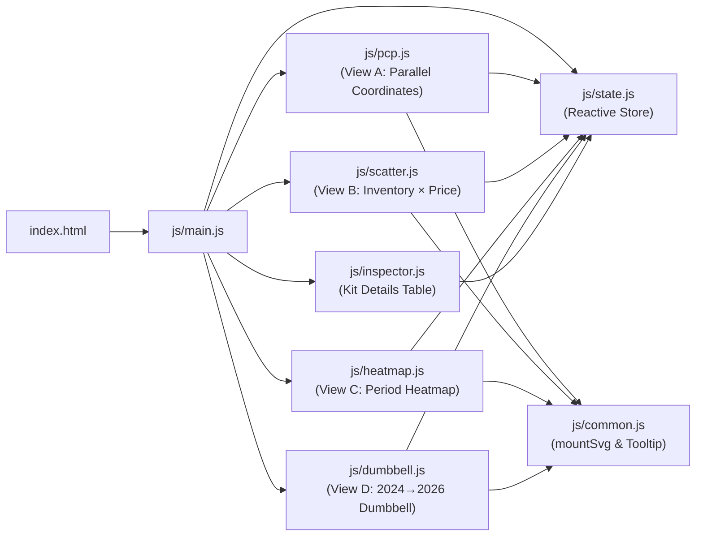

# Architecture & Coordinated Views

**SiliconAIShock** is built as a zero-build, native ES module single-page dashboard powered by **D3.js v7**. All four visualization panels and the kit inspector communicate through a central reactive state store ([`js/state.js`](../js/state.js)).

---

## 1. Module Dependency Graph

| File | Responsibility |
| :--- | :--- |
| [`index.html`](../index.html) | Topbar controls (generation legend, layout switcher, active kit counter, reset button) and 5-panel grid container. |
| [`css/style.css`](../css/style.css) | Single-screen `100vh` CSS Grid (`20` columns × `2` rows) with two live-switchable layout configurations. |
| [`js/main.js`](../js/main.js) | Loads `data/processed_data.json`, initializes `state`, mounts all views, and wires the header counter and reset button. |
| [`js/state.js`](../js/state.js) | Central state singleton managing multi-view filtering (`AND` composition), hover/pin highlighting, and event listeners. |
| [`js/common.js`](../js/common.js) | `mountSvg()` helper using `ResizeObserver` for responsive SVG rendering and viewport-aware floating tooltips. |
| [`js/pcp.js`](../js/pcp.js) | **View A:** 6-axis Parallel Coordinates Plot with independent vertical `d3.brushY` brushes per axis. |
| [`js/scatter.js`](../js/scatter.js) | **View B:** Continuous Scatter Plot (`global_inventory_weeks` vs. `price_per_gb`) with 2D `d3.brush` and scarcity threshold annotation. |
| [`js/heatmap.js`](../js/heatmap.js) | **View C:** Categorical Heatmap (`generation × segment` vs. `half-year`) displaying dynamic median `US$/GB`. |
| [`js/dumbbell.js`](../js/dumbbell.js) | **View D:** Dumbbell Chart comparing pre-crisis (`2024`) vs. peak shortage (`2026`) median prices across usage tiers. |
| [`js/inspector.js`](../js/inspector.js) | **Details Card:** Tabular inspector displaying all 17 attributes for the hovered or pinned DRAM kit. |

---

## 2. Brushing & Linking State Machine (`js/state.js`)

The dashboard maintains **four orthogonal filter channels**, combined via logical **`AND`**:

1. **`state.pcp`** — Dictionary of `{ [axisKey]: [min, max] }` active ranges brushed on any of the 6 Parallel Coordinates axes.
2. **`state.box`** — `{ x: [minWeeks, maxWeeks], y: [minPrice, maxPrice] }` 2D bounding box brushed on the Scatter Plot.
3. **`state.cell`** — `{ generation, market_segment, half }` selected by clicking a cell in the Heatmap (clicking again toggles it off).
4. **`state.usage`** — `recommended_usage` string selected by clicking a row in the Dumbbell Chart (clicking again toggles it off).

### Cross-Filtering & Contextual Aggregation (`state.matches(d, opts)`)

To prevent aggregated views from collapsing into a single cell or row when clicked, `state.matches(d, opts)` supports selective filter exclusion:

- **Individual Kit Views (PCP & Scatter):** Use `state.selected` (kits passing **all** 4 filter channels). Unselected kits are styled with `.out` (dimmed into background context), while selected kits are raised to the foreground (`.raise()`).
- **Heatmap (`js/heatmap.js`):** Calls `state.matches(d, true)` (`ignoreCell: true`) so clicking a cell filters the other views while keeping all 36 heatmap cells visible (with non-selected cells styled as `.dimmed`) and dynamically recomputing medians from the active PCP, Scatter, and Dumbbell filters.
- **Dumbbell Chart (`js/dumbbell.js`):** Calls `state.matches(d, { ignoreUsage: true, ignoreHalf: true })` so clicking a usage row or a specific semester in the heatmap still allows comparing the full `2024 → 2026` price jump for that memory generation/segment, while keeping a light grey **ghost line** (`.db-ghost-line`) showing the unfiltered baseline jump.

---

## 3. Visual Encodings & Design Choices

### Shared Color Palette (`GEN_COLORS`)
Consistent color encoding across the Topbar Legend, Parallel Coordinates, Scatter Plot, and Inspector card border:
- **DDR4:** `#2563eb` (Royal Blue)
- **DDR5:** `#0d9488` (Teal)
- **DDR6 (Preview):** `#d97706` (Amber/Orange)

### Logarithmic vs. Linear Scales
DRAM prices and bandwidth efficiency span more than an order of magnitude across DDR4 (`~$3/GB`) and DDR6 (`~$140/GB`). Accordingly:
- **Logarithmic Scales (`d3.scaleLog` / `d3.scaleSequentialLog`):** Used for `price_per_gb` and `bandwidth_per_dollar` in the PCP, the Y-axis of the Scatter Plot, and the `YlOrRd` color scale of the Heatmap.
- **Square-Root Area Scale (`d3.scaleSqrt`):** Used for kit capacity (`capacity_gb`, `8 GB` to `512 GB`) in the Scatter Plot so circle area is perceptually proportional to capacity, sorted largest-first so small kits are never occluded.

### Pointer-Event Layering
- **Parallel Coordinates (`js/pcp.js`):** Renders visible polylines (`1.5px` stroke) underneath invisible `8px`-wide `.pcp-hit` paths for effortless mouse hover/click targeting between axes, while `24px`-wide axis brush strips sit on top.
- **Scatter Plot (`js/scatter.js`):** Places `<g class="brush">` **underneath** `<g class="dots">` so hovering or clicking a circle always reaches the kit, whereas dragging on empty canvas initiates a 2D rectangular brush.

---

## 4. Responsive Dual-Layout Grid

[`mountSvg()`](../js/common.js) attaches a `ResizeObserver` to every `.view` container, automatically redrawing and preserving active brush selections whenever the window resizes or the user switches between the two built-in grid layouts:

- **Layout 1 · Base 3 painéis (`bottom3`, default):**
  - **Top Row:** Parallel Coordinates (`80%` width, cols `1–16`) + Kit Details Inspector (`20%` width, cols `17–20`).
  - **Bottom Row:** Scatter Plot (`35%`, cols `1–7`) + Heatmap (`35%`, cols `8–14`) + Dumbbell Chart (`30%`, cols `15–20`).
- **Layout 2 · Coluna direita dividida (`rightsplit`):**
  - **Left/Center Area:** Parallel Coordinates on top (`75%`, cols `1–15`), Scatter Plot (`35%`, cols `1–7`) and Heatmap (`40%`, cols `8–15`) on bottom.
  - **Right Column (`25%`, cols `16–20`):** Vertically split between the Dumbbell Chart (top) and Kit Details Inspector (bottom).
