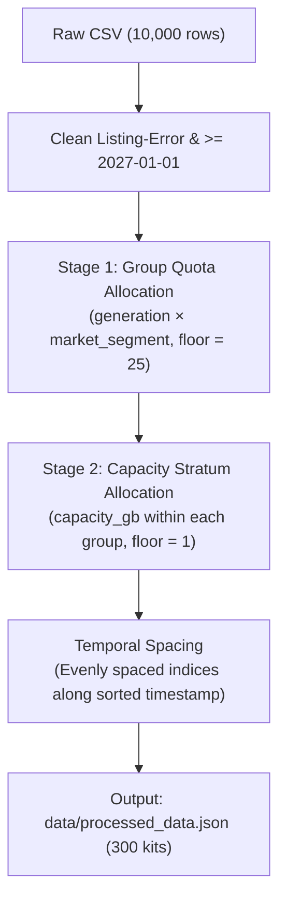

# Data Pipeline & Stratified Sampling

This document describes the raw dataset, data cleaning rules, two-stage stratified downsampling algorithm, and output schema used by [`scripts/preprocess.py`](../scripts/preprocess.py) to produce [`data/processed_data.json`](../data/processed_data.json).

---

## 1. Raw Dataset Overview

- **Source File:** [`data/raw/Ultimate_Memory_Shortage_Crisis_Dataset_10k.csv`](../data/raw/Ultimate_Memory_Shortage_Crisis_Dataset_10k.csv)
- **Total Records:** 10,000 DRAM kits
- **Study Period:** January 2024 – December 2026 (representing the transition from pre-crisis inventory levels to peak AI/HBM-driven supply shortage)

### Why Downsample to 300 Kits?

Rendering 10,000 polylines simultaneously in a SVG-based Parallel Coordinates Plot (PCP) causes severe visual clutter (*overplotting*) and degrades interactive brushing frame rates. Downsampling to **300 representative kits** preserves:
1. Smooth 60 FPS interactive brushing across all four coordinated D3.js views.
2. Clear visual separation of individual polylines and scatter points.
3. Complete coverage of every `(generation, market_segment) × half-year` cell in the heatmap and every `recommended_usage` category in the dumbbell chart.

---

## 2. Cleaning & Filtering Rules

Before sampling, [`scripts/preprocess.py`](../scripts/preprocess.py) applies two deterministic cleaning rules:

1. **Remove Price Anomalies (`Listing-Error`):**
   ```python
   df = df[df["price_status"] != "Listing-Error"]
   ```
   Drops corrupted marketplace listings with anomalous outlier pricing that would distort logarithmic scales and median calculations.

2. **Enforce Study Window (`2024–2026`):**
   ```python
   df = df[df["timestamp"] < "2027-01-01"]
   ```
   Removes 5 boundary rows dated `2027-01-01` so the half-year heatmap cleanly spans the six semesters from `2024-H1` to `2026-H2`.

---

## 3. Two-Stage Stratified Downsampling

A naive uniform random sample would under-represent smaller emerging categories—most notably **`DDR6 (Preview)`**—leaving sparse or empty cells in the semester heatmap. To guarantee readability across all segments, [`scripts/preprocess.py`](../scripts/preprocess.py) uses a deterministic two-stage allocation:



### Stage 1: `(generation, market_segment)` Quota (`MIN_PER_GROUP = 25`)
Every `(generation, market_segment)` combination receives a guaranteed floor of **25 records**, with the remaining budget distributed proportionally to group size using largest-remainder rounding (`allocate()`):

| Generation | Market Segment | Sampled Kits | Share |
| :--- | :--- | ---: | ---: |
| **DDR4** | Consumer | 45 | 15.0% |
| **DDR4** | Enterprise/AI | 42 | 14.0% |
| **DDR5** | Consumer | 57 | 19.0% |
| **DDR5** | Enterprise/AI | 100 | 33.3% |
| **DDR6 (Preview)** | Consumer | 26 | 8.7% |
| **DDR6 (Preview)** | Enterprise/AI | 30 | 10.0% |
| **Total** | | **300** | **100.0%** |

### Stage 2: Capacity Stratification & Even Temporal Spacing
Within each `(generation, market_segment)` group:
1. Records are sub-stratified by `capacity_gb` (with a minimum floor of `1` kit per capacity tier).
2. Within each `(generation, market_segment, capacity_gb)` stratum, `k` records are selected at **evenly spaced positions** along the time-sorted index (`np.linspace(0, len(group) - 1, k).round().astype(int)`), ensuring balanced coverage across all six half-year periods (`2024-H1` through `2026-H2`).

---

## 4. Output Schema (`data/processed_data.json`)

Each of the 300 JSON objects in [`data/processed_data.json`](../data/processed_data.json) contains **19 attributes** (no synthetic/derived columns added during preprocessing):

| Field | Type | Unit / Format | Description & Visual Role |
| :--- | :--- | :--- | :--- |
| `kit_id` | `string` | `MPN-XXXXXX` | Unique identifier for selection, hover, and pinning (`state.byId`). |
| `brand` | `string` | Categorical | Module brand (e.g., Corsair, Kingston, G.Skill, SK Hynix) — shown in Inspector. |
| `model_name` | `string` | Text | Full commercial kit label — shown in Tooltip & Inspector header. |
| `timestamp` | `string` | `YYYY-MM-DD` | Observation date — mapped to half-year (`2024-H1`..`2026-H2`) and year (`2024` vs `2026`). |
| `region` | `string` | Categorical | Geographic market (`North America`, `Europe`, `EMEA`, `Asia-Pacific`, `Latin America`, `Greater China`). |
| `generation` | `string` | Categorical | Memory generation (`DDR4`, `DDR5`, `DDR6 (Preview)`) — primary color encoding. |
| `market_segment` | `string` | Categorical | `Consumer` or `Enterprise/AI` — Heatmap row grouping. |
| `recommended_usage` | `string` | Categorical | `AI / Data Science`, `Content Creation`, `Gaming (AAA)`, `Basic Productivity` — Dumbbell rows. |
| `die_manufacturer` | `string` | Categorical | Underlying DRAM die fab (`SK Hynix`, `Samsung`, `Micron`) — shown in Inspector. |
| `capacity_gb` | `number` | GB (`8`–`512`) | Total kit capacity — encoded as circle area (`scaleSqrt`) in the Scatter Plot. |
| `speed_mts` | `number` | MT/s | Transfer rate (`2133`–`21000` MT/s) — PCP Axis 3. |
| `true_latency_ns` | `number` | ns | True first-word latency in nanoseconds — PCP Axis 4. |
| `price_per_gb` | `number` | US$/GB | Unit price — PCP Axis 5 (log), Scatter Y-axis (log), Heatmap & Dumbbell median metric. |
| `price_usd` | `number` | US$ | Total retail/contract kit price — shown in Inspector. |
| `bandwidth_per_dollar`| `number` | MB/s per US$ | Value efficiency metric — PCP Axis 6 (log). |
| `speed_premium_ratio` | `number` | Multiplier (`×`) | Price ratio vs. baseline JEDEC speed — shown in Inspector. |
| `global_inventory_weeks`| `number` | Weeks | Global supply buffer (`0`–`16` weeks; `< 8` is critical shortage) — PCP Axis 2 & Scatter X-axis. |
| `fab_utilization_rate`| `number` | Ratio (`0.50`–`1.00`) | Wafer fab utilization rate — PCP Axis 1. |
| `gpu_hbm_trend_gb` | `number` | GB | Concurrent HBM capacity demand proxy in AI accelerators — shown in Inspector. |

---

## 5. Re-running the Pipeline

From the repository root:

```bash
python -m venv .venv
# Windows PowerShell
.venv\Scripts\Activate.ps1
pip install -r requirements.txt
python scripts/preprocess.py
```

The script prints row counts at each filtering stage, the group quota breakdown, and a verification pivot table confirming that all 36 `(generation, market_segment) × half-year` heatmap cells are populated.
